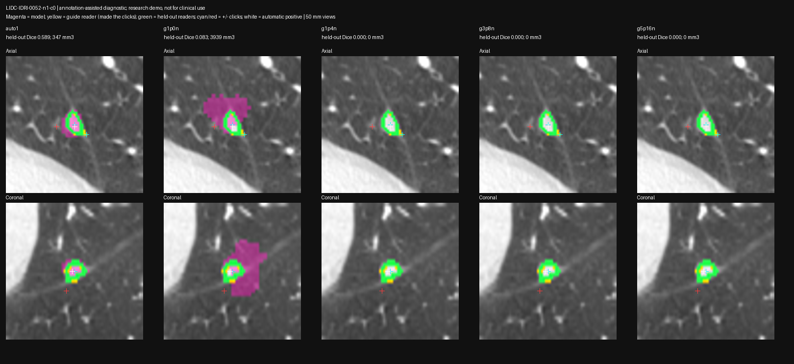
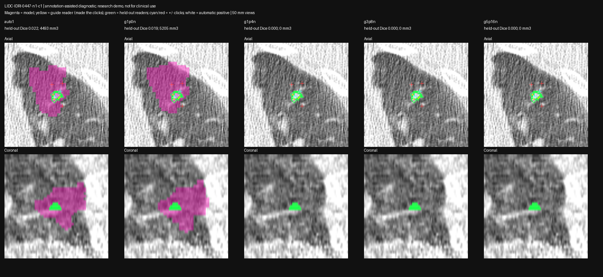
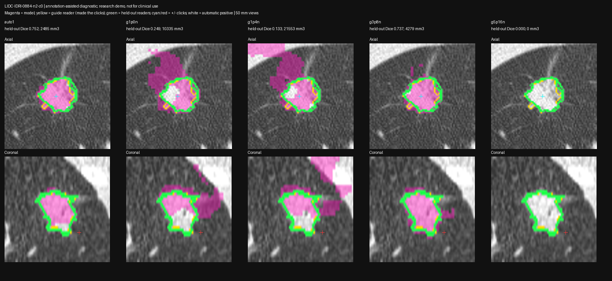

# VISTA annotation-assisted click diagnostic — 2026-10-24

Status: **capability diagnostic FAILED — stronger explicit guidance does not recover a correct boundary in this stack**; frozen rule `clicks-assisted-v1`. This is an **annotation-assisted capability diagnosis**, not automatic-pipeline validation. No sizes, growth, VDT or categories accepted.

## Question

Can explicit reader-assisted foreground/background clicks make the local VISTA-3D path outline the target nodule, where the automatic one-point strategy fails? This separates "the one-point automatic prompt is too weak" from "the loaded inference path cannot outline the target even with strong guidance".

## Frozen design (before any inference)

Code `bench/vista_click_probe.py`; rule JSON in this directory. Laptop RTX 3080 (spark-2 was busy with the reliability probe; direct-MONAI path already reproduced GB10 masks at Dice 0.996–1.000 in `2026-10-24-vista-conditioning.md`). Same vendor preprocessing/inferer/postprocessing, same exact 64 mm crop inputs (SHA256-verified), strict original weights.

- Targets: `LIDC-IDRI-0052-n1-c0` (moderate), `LIDC-IDRI-0447-n1-c1` (small failure), `LIDC-IDRI-0884-n2-c0` (good). Diagnostic selection from prior results, not held-out validation.
- Guide/held-out split: the group's **first** reference file is the guide reader; its contour is the *only* click source. Remaining readers (3/2/3) score every mask against complete masks, never truncated to the crop.
- Positives: farthest-point sampling in physical mm over guide-mask voxels, seeded at the deepest physical-EDT voxel.
- Negatives: physical distance to the guide mask in **(2, 4] mm** (near-boundary shell, chosen to counter the observed boundary leakage), inside the crop, outside **every** annotated group of the case; farthest-point sampling, seeded at the closest candidate. All 8 azimuth bins populated on all targets; every click verified in its intended set.
- Conditions (fixed budgets): `auto1` = unchanged automatic single positive (baseline control); `g1p0n` guide positive only; `g1p4n` 1+/4−; `g3p8n` 3+/8−; `g5p16n` 5+/16−. Flags 1/0 per the vendor inferer's documented convention; no class prompts; no cleanup; point-only decode `==1` (255 uncomputed).
- A point-head hook verifies delivered labels; a monitor aborts below 15 GiB host / 1 GiB GPU.

Prepared click previews were inspected before inference (`click-previews/`).

## Controls pass

`auto1` reproduces the GB10 HF-wrapper baselines at Dice **1.000/0.996/0.9979** and the same-device conditioning `point1` masks at **1.000** on all three targets. Harness equivalence to all prior runs is established before reading anything below.

## Results (held-out reader Dice per reader; guide Dice in parentheses)

| Target | auto1 | g1p0n | g1p4n | g3p8n | g5p16n |
| --- | --- | --- | --- | --- | --- |
| 0052-n1 (moderate) | **0.589/0.539/0.594** (0.530) | 0.083/0.060/0.102 (0.075); 3,939 mm³; 88% leak>2mm; 5 comps | empty | empty | empty |
| 0447-n1 (small failure) | 0.033/0.012 (0.014); 4,493 mm³; 95% leak | 0.028/0.010 (0.012); 5,205 mm³; 96% leak | empty | empty | empty |
| 0884-n2 (good) | **0.752/0.737/0.765** (0.781) | 0.234/0.249/0.258 (0.243); 10,335 mm³; crop-face contact | 0.125/0.133/0.141 (0.134); 21,553 mm³; 88% leak; crop-face contact | 0.703/0.737/0.749 (0.693); 4,279 mm³ | empty |

Key facts:

1. **No assisted condition improves on the automatic single positive.** Best case is 0884 `g3p8n` ≈ baseline with slightly worse volume error; every other assisted condition is equal-or-worse, usually catastrophically.
2. **A guide-reader positive alone degrades all three targets** (0.59→0.08, 0.033→0.028, 0.75→0.25) with multi-component, leaking masks. The model does not reliably segment the object containing a given interior point — extreme sensitivity to positive placement, consistent with the earlier crop-size and jitter instability.
3. **Near-boundary negatives collapse the prediction at the positive point and empty the output.** Masked-vs-logit tracing (`bench/vista_click_debug.py`): 0052 `g1p4n` has real foreground elsewhere (413-voxel logit>0 component) but the logit **at the positive point is −17.1**; 0447 prob@positive 0.16; 0884 `g5p16n` prob@positive 0.0000. The native point-only post-filter `keep_components_with_positive_points` then finds the positive in no foreground component and deletes everything → empty mask. So the empties are a *model response to the negatives* surfaced by the documented post-processing, not a scoring or decode artifact.
4. Guide Dice tracks held-out Dice closely — the outputs do not even fit the reader whose contour generated the clicks.
5. Hook traces: with N clicks the point-window inferer makes N window calls, each receiving the complete click set (no silent point dropping); class vector stays `None` throughout.

## Interpretation

Combined with the checkpoint-identity pass and exact control reproduction (`2026-10-24-vista-conditioning.md`), weights, crop geometry, seed placement and the HF loader are excluded as explanations. The failure pattern — output collapses under the documented interactive-guidance route itself — points at the point-conditioning/inference behavior of this MONAI 1.6.1 + torch 2.14 runtime combination (aarch64 GB10 unverified for this specific ablation, but its point-only outputs are reproduced exactly here). VISTA-3D in this stack is **not usable as an interactive nodule segmentation tool for our targets**, and the automatic one-point configuration was already rejected. Keep threshold/detector-box derived measurements out of reports regardless; no measurement, VDT or category may cite any VISTA mask from tonight's runs.

Next discriminating step, if any: run the same frozen click rule against NVIDIA's reference TotalSegmentator/VISTA runner (weights-compatible reference implementation) to split "our runtime integration is wrong" from "the checkpoint cannot do this". Do not spend more time tuning crops, flags or click budgets — three independent frozen experiments now agree the current path is the problem.

## Limitations

Three diagnostic targets selected from previous failures (not a cohort); one guide/held-out split per target; reader contours imperfect (reader-pair Dice 0.775 median); negatives tested at flag0 only (flag2 is the special-class variant, off-spec without a class prompt); laptop x86/Python 3.14 results with GB10/aarch64 point-only equivalence established via controls only; `VistaPostTransformd` component filtering is part of the documented point-only route and was deliberately not bypassed.

## Runtime and evidence

Laptop ty-omarchy RTX 3080 (55% VRAM cap): model load 8.73 s; 15 VISTA calls; min host MemAvailable **30.50 GiB**, min GPU free **3.96 GiB**; probe exited cleanly. spark-2 untouched (reliability probe was running; no second GPU job started there). Torch 2.14.1+cu130 / MONAI 1.6.1 / einops 0.8.2, Python 3.14.8.

Commands: `~/venvs/spark-md-x86/bin/python bench/vista_click_probe.py prepare|infer|summary --out tmp/vista-click-20261024-03 --refs tmp/lidc-vista-references-v3`; overlays `bench/vista_click_overlays.py --out … --refs …`; logit tracing `bench/vista_click_debug.py`. This directory holds rule, clicks, results, memory log, click previews and overlays; raw masks/NIfTIs and sparse coordinates remain in `tmp/vista-click-20261024-03/` on the laptop. References: `tmp/lidc-vista-references-v3/` (LIDC-IDRI/TCIA CC BY 3.0 via IDC; citations in `data/README.md`).

