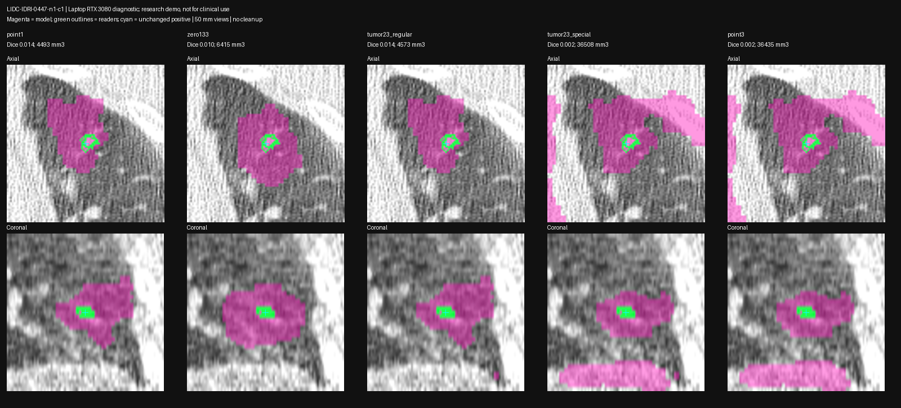

# VISTA checkpoint and conditioning audit — 2026-10-24

Status: **loader identity passed; class/flag ablations did not rescue the selected failure**. No accepted clinical measurements.

## CPU checkpoint audit (spark-2)

`bench/vista_loader_audit.py` computes per-tensor hashes of the original staged NVIDIA `model.pt` (259 unprefixed tensors, file SHA256 `c92bab26d00b4a5d89fa8a383900cdeb88302fd318e5e816df0bbec7106d9a1b`). Converted remote checkpoint has the same 259 tensor values under `network.` names. Transformers `VISTA3DModel.from_pretrained(..., local_files_only=True, output_loading_info=True)` on CPU loads all 259 exactly, with no missing, unexpected, mismatched keys or loading errors. Thus this audit finds no lost/reinitialized weights in the existing conversion/loading path. Functional compatibility is a separate question.

Torch 2.14.1+cu130, MONAI 1.6.1, transformers 4.46.3 on spark-2. All audited parameters on CPU; no GPU inference in this audit. Existing `vista_reliability_probe.py` was already running on spark-2 when this task started and was left untouched. No second GPU job was started there.

## Source findings

Primary sources are the pinned bundled vendor README/pipeline/inferer (`models/vista3d-nv-segment-ct`, revision `afb51518689f71e6abb367ee6301b2cd0225c66a`) and installed MONAI source:

- README explicitly permits point-only prompts and novel-object label prompts 133–254 together with points. `133` is not a named nodule class; it requests the novel-object route.
- `PointMappingSAM.forward`: no class vector uses `supported_embed`; class > `last_supported=132` uses `zeroshot_embed`. The vendor inferer removes a novel class's automatic class vector but retains it as `prompt_class` for the point head.
- Bundled metadata class 23 = "lung tumor". Installed `VistaPreTransformd.special_index` defaults to `[25,26,27,28,29,117]` and leaves class23 positive as **1**. The same installed network's `convert_point_label(...,[23])` maps positive to **3** (special tumor click). This is a concrete preprocessing/network conversion disagreement. It does not by itself explain prior *classless* point-only failures.
- Point/class conditions also have different native postprocessing: point-only applies positive-component filtering before thresholding, while class-prompted output maps to its class value. Account for that when interpreting output differences.

## Frozen diagnostic experiment

`bench/vista_conditioning_probe.py`, rule `conditioning-direct-v1`. **Laptop RTX 3080**, not GB10: existing spark-2 GPU job is left running. Original checkpoint loaded strictly into MONAI `vista3d132`; vendor preprocessing, bundled inferer and postprocessing sequence reproduced directly without transformers. Same MONAI/torch versions; Python 3.14 instead of spark-2's 3.12. Laptop venv added offline pure-Python einops 0.8.2 from wheelhouse. No system packages/model edits.

Four targets, selected explicitly for diagnosis from prior results, **not held-out validation**: LIDC-0052 n1 (moderate previous overlap), LIDC-0447 n1 (small failure with positive inside all readers), LIDC-0884 n2 (good previous overlap), hero 134503 T0 (no contour reference). Exact previous 64 mm input files and fixed positive points, verified by SHA256; no negative points or reader-driven point edits.

Five conditions per target, frozen before output: point-only flag1 control; novel class133 + flag1; supported lung-tumor class23 + regular flag1; class23 + special flag3; point-only flag3. Hook actual point-head class/flag and class-head calls. Decode native class labels correctly, check geometry/gates, compare full reader masks and compare the control against the previous GB10 HF-wrapper baseline. A CPU checkpoint identity pass does not ensure a separately reproduced inference path is equivalent; control agreement is required before attributing changes to conditioning.

Memory: laptop CUDA0 process capped at 55% of total VRAM, abort below 1 GiB GPU free or 15 GiB host available. No other laptop imaging workload observed. Fresh completed-run target `tmp/vista-conditioning-20261024-02/`; `-01/` holds an initial harness failure (MONAI in-place postprocessing cannot mutate inference-mode tensors outside that context). Corrected runner uses `torch.no_grad()` as the vendor eval path; failed run yielded no masks or scientific comparison. Inputs and original hash manifest remain read-only in `-01/`.

## Results

All 20 conditions completed. Point-only direct-MONAI controls match the prior GB10 HF-wrapper masks with Dice **0.9960–1.0000**: exact for 0052 and hero T0, 0.9960 for 0447, 0.9979 for 0884. This substantially reproduces the prior inference behavior on these inputs; small cross-device numerical differences remain. The reader-overlap failure is reproducible without the HF wrapper.

Median Dice vs separate complete reader masks, identical metric implementation as the previous LIDC evaluation:

| Diagnostic target | Point flag1 | Zero-shot133 flag1 | Class23 flag1 | Class23 flag3 | Point flag3 |
| --- | ---: | ---: | ---: | ---: | ---: |
| LIDC-0052 n1 | 0.5641 | 0.3824 | 0.5641 | 0.5653 | 0.5653 |
| LIDC-0447 n1 | 0.0143 | 0.0100 | 0.0141 | 0.0018 | 0.0018 |
| LIDC-0884 n2 | 0.7584 | 0.7099 | 0.7432 | 0.7450 | 0.7577 |

The explicit novel-object route lowers overlap on all three selected LIDC targets. The special tumor flag does not rescue the small failure: 0447 flag1 foreground ~4,493 mm³, class23+flag3 ~36,508 mm³. All its five conditions fail the coarse technical gates. Some other conditions change overlap only slightly; no broadly favorable setting is established. Hero T0 has no reference contour; its foreground volumes are 347/612/556/596/388 mm³ in the table's condition order, not accepted patient measurements.

Hook traces confirm the intended routes: zero133 reaches the point head with class133 and flag1, without an automatic class-head call; class23 conditions invoke the class head once and reach the point head with flags1/3 respectively; point-only flag3 reaches the point head as flag3 with no class vector. Native labels are correctly 1, 133 or 23 by condition and decoded explicitly. No flag/class condition silently fell back to the point-only control.

All four axial/coronal diagnostic sheets were inspected. Reader outlines remain on the target, while the selected small failure still includes surrounding lung across settings. The checkpoint identity and direct-control results provide no evidence of lost weights or a gross HF-loader/wrapper divergence explaining that failure. Functional differences from other MONAI/runtime versions remain possible and untested; the discovered class23 flag inconsistency is real but **not a demonstrated segmentation fix**.

No sizes/growth/VDT/categories accepted; keep the previous full-cohort reader/stability rejection. These are selected **laptop diagnostic** results, not a new independent performance estimate. GB10 class/flag ablation and complete-cohort rerun remain unverified; do not change the default or silently patch special-class flags based on this sample.

## Next discriminating experiment

Use explicit reference-assisted foreground/background clicks on an aligned LIDC failure, with fixed click budgets and separate reader masks for assessment. Label this as an **annotation-assisted capability diagnostic**, not automatic pipeline validation. It distinguishes failure of the current automatic one-point strategy from a model/inference path that cannot outline the target even with strong guidance. Preserve the fixed automatic baseline; keep point/class and runtime compatibility limits visible. Native class-dependent postprocessing means this experiment's differences cannot all be attributed solely to one embedding token.

## Performance and cleanup

RTX 3080 model initialization 8.54 s (strict CPU load + transfer). Minimum laptop host MemAvailable **35.88 GiB**, minimum GPU free **4.30 GiB** at 0.5 s samples; 55% CUDA process cap, 15 GiB host/1 GiB VRAM abort floors were not approached. Laptop probe exited and VRAM returned to ~7.6 GiB free. The concurrent spark-2 reliability process was left untouched and may still be running; this task did not start or stop it. No persistent service or model file changed.

## Evidence and attribution

CPU audit `2026-10-24-vista-conditioning/loader-audit.json`; original per-tensor hashes, frozen rule/jobs, result/trace JSON, explicit review, memory log and all diagnostic sheets are in that directory. Raw native/binary masks and original-index sparse coordinates remain at `tmp/vista-conditioning-20261024-02/` on the laptop; exact prior inputs and GB10 baseline masks are read-only in `-01/inputs/`. Original vendor inferer source SHA256 `e775bc457aa98d57628eb677098ed9942f6a43e5d36e1e5b8ad2f5267c5f4bc3` matches the remote inferer. Source/input checksums are recorded; no model checksums changed.

Commands: laptop x86 venv, `python bench/vista_conditioning_probe.py --out tmp/vista-conditioning-20261024-02 --vendor models/vista3d-nv-segment-ct --refs tmp/lidc-vista-references-v3`; overlay renderer `bench/vista_conditioning_overlays.py` takes the same out/refs arguments. Initial `jobs.json` stages exact previous crops and baseline coordinates, with original remote paths/hashes. CPU audit command is `bench/vista_loader_audit.py original|loaded` with explicit source/expected/vendor/out arguments. Prior reference geometry/exclusions and reader scoring definitions remain those in `2026-10-24-vista-lidc.md`. NLST/TCIA CC BY 4.0 and LIDC-IDRI/TCIA CC BY 3.0 via IDC; citations in `data/README.md`.

