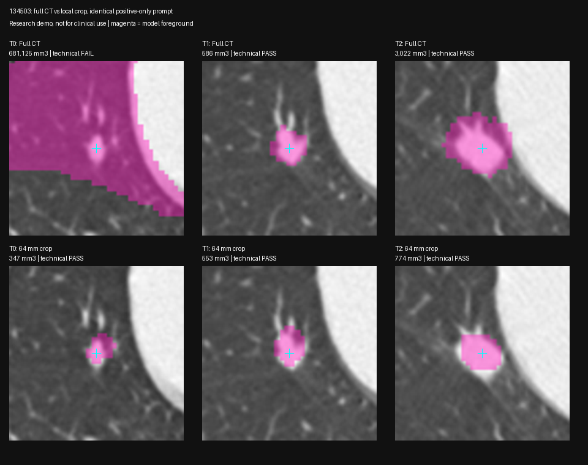

# VISTA detector-centered local crop — 2026-10-24

Status: **3/3 cropped outputs pass frozen gross-failure checks; boundary/measurement accuracy remains unverified** on spark-2 GB10. Follows `2026-10-24-vista-longitudinal.md` (full-volume automatic prompts failed on T0). No clinical findings or categories produced.

**Follow-up outcome:** the later LIDC reader-contour and crop-size evaluation failed for this configuration (median Dice64 0.033; hero volume spans 42–71%). The technical pass recorded here is not an accepted measurement result. See `2026-10-24-vista-lidc.md`.

## Frozen experiment

- Rule `hero-crop64-v1`, code `bench/vista_crop_probe.py`; frozen `rule.json` before inference in fresh `~/spark-md-b/vista-probe-20261024-05/`. Same rule on T0/T1/T2, no manual points or scan-specific tuning.
- Candidate identities remain Farina-reference-assisted inputs. Not an automatic detection/matching evaluation.
- Use the detector-box seed from the prior v2 method, positive voxels `[230,391,59]`, `[228,386,66]`, `[220,385,66]`. HU ≥−400 within the predicted physical box; nearest 6-connected tissue component; maximum physical EDT; no opening.
- Compare **full CT positive-only** versus **64 mm crop positive-only**, using the exact same physical positive point, no negatives and no class prompt. This is a controlled comparison of local vs full input. Unlike the previous two-pass runs, prompt sets do not change with condition.
- Crop center = corrected detector center. Axis counts `ceil(64 / original spacing)`; start `floor(center - count/2)`, intersect image bounds; no intensity changes, resizing or external padding. Actual extents due to voxel rounding: T0 64.125×64.125×64 mm, T1 64.180×64.180×64 mm, T2 64.453×64.453×64 mm. VISTA's own resampling/padding remains unchanged.
- Crop affine = original affine times voxel translation by crop start. Local positive = original positive minus start. Verified exact HU equality to the original subarray and zero physical-point roundtrip error in all three crops.
- Label-1 output is restored by placing the crop labels into that same original-index block, preserving original affine; no interpolation. Original voxels outside the crop are marked **255, not evaluated**, not asserted to be background. No post-hoc mask cleanup or clipping to the detector box.

## Predeclared technical checks

Research gross-failure checks, not clinical accuracy thresholds: allowed labels 0/1/255; output shape and affine match input; nonempty foreground includes positive; largest foreground bounding extent ≤3×largest detector-box dimension; foreground volume ≤4×predicted box volume; cropped foreground has ≥5 mm physical clearance from every crop face. Report face contact separately. This detects crop truncation instead of accepting any smaller mask as improvement. No patient findings accepted without independent boundary validation.

Offline local model; same MONAI 1.6.1 / transformers 4.46.3 shims as prior probes. TensorFold/OpenClaw stay running. Start ~70 GiB available, 0.5 s host MemAvailable monitor, abort only probe below 15 GiB, one imaging GPU process. Exact event wheelhouse torch 2.13 remains unverified.

Commands: `~/venvs/spark-md-arm/bin/python -u ~/spark-md-b/vista_crop_probe.py prepare --out ~/spark-md-b/vista-probe-20261024-05`, then same with `infer`. Prepared data and frozen rule are saved first; no cached inference reused.

## Results

Completed unchanged on all three scans, Oct 24 on spark-2 GB10. Every output matched its input shape/affine and contained the same physical positive point. Cropped outputs restored onto the original grid without label loss or interpolation; all original voxels outside the crop remain explicitly uncomputed.

| Timepoint | Full CT volume mm³ | Crop volume mm³ | Crop bounding extent mm | Crop edge clearance mm | Crop pipeline seconds | Technical result |
| --- | ---: | ---: | --- | ---: | ---: | --- |
| T0 | 681,125.2 | 347.4 | 9 × 9 × 12 | 25.00 | 0.386 | PASS |
| T1 | 585.8 | 552.8 | 12.1 × 9.1 × 10 | 25.73 | 0.368 | PASS |
| T2 | 3,021.8 | 774.3 | 11.6 × 11.6 × 12 | 23.53 | 0.361 | PASS |

Each cropped mask is one connected region with only labels 0 and 1. No cropped foreground touches a face. The T0 full-CT control fails extent and volume limits; full T1/T2 pass the coarse gates. The full-CT and crop calls use the same positive without any negatives, so their differences are not explained by changed point sets.

Visual review of the axial/coronal/sagittal prompt planes: all three cropped masks are localized to the target neighborhood; the prior T0 lung-sized inclusion is gone. Full CT T0 still has lung-scale foreground with the correct positive, reproducing the gross failure. No manual cleanup or edits were used. Restored CT overlay checks agree with crop overlays; the minimum >23 mm foreground-to-edge margin rules out simple crop truncation as the source of a compact mask.

**Technical pass is not independent accuracy validation.** T0 cropped bbox 9×9×12 mm differs from NLST 7×5 mm reader measurements; T2 cropped bbox ~11.6×11.6×12 mm differs from NLST 14×14 mm. These are different measurement definitions and cannot be equated, but they show that localization is not proof of accurate sizing. T0 also has mean foreground HU ~−532, suggesting included lower-attenuation surrounding voxels; without a reference contour this is a diagnostic observation, not proof of tissue type or nodule composition. The same 1.5 mm internal model resampling remains; cropping changes context, padding and resampling-grid phase, so this experiment does not identify which internal mechanism caused the improvement.

No clinical diameter, growth, VDT or category is recomputed from these masks. Historical T0 fallback and previous full-CT VISTA sequences remain invalidated/rejected as documented in the longitudinal record. All `accepted_for_patient_findings` flags remain false. Next validation: LIDC reader contours across nodule sizes, plus crop-size/position stability, before adopting this for longitudinal measurement.

## Performance and verification

One invocation per condition, same model process. Full-CT pipeline 3.34 / 2.33 / 2.20 s; crop pipeline 0.386 / 0.368 / 0.361 s, excluding separate seed/crop preparation, model load, diagnosis/plots and restoration. Model initialization 6.60 s; cropped calls follow full calls and are warm. Not a latency distribution or end-to-end per-study time.

Minimum host MemAvailable **63.79 GiB**, sampled every 0.5 s, with TensorFold/OpenClaw running. Probe exited; no imaging process remains; post-run ~70 GiB available. Torch 2.14.1+cu130, MONAI 1.6.1, transformers 4.46.3. Exact event wheelhouse torch 2.13 remains unverified.

Synthetic gate sanity check: a compact centered test mask passes; an all-foreground crop fails extent, volume and edge checks and reports face contact. Raw `technical-gate-sanity.json`. Real-input assertions verify HU equality, zero prompt physical roundtrip error, restored original grid, unchanged foreground count and exact crop label placement.

## Evidence

Full input crops, VISTA outputs and restored labels remain remote in `~/spark-md-b/vista-probe-20261024-05/`. Summaries, transforms, logs, overlays and hashes are in `2026-10-24-vista-crop/`. NLST/TCIA CC BY 4.0 via IDC, Farina reference points used for candidate selection; full attribution in `data/README.md`.

