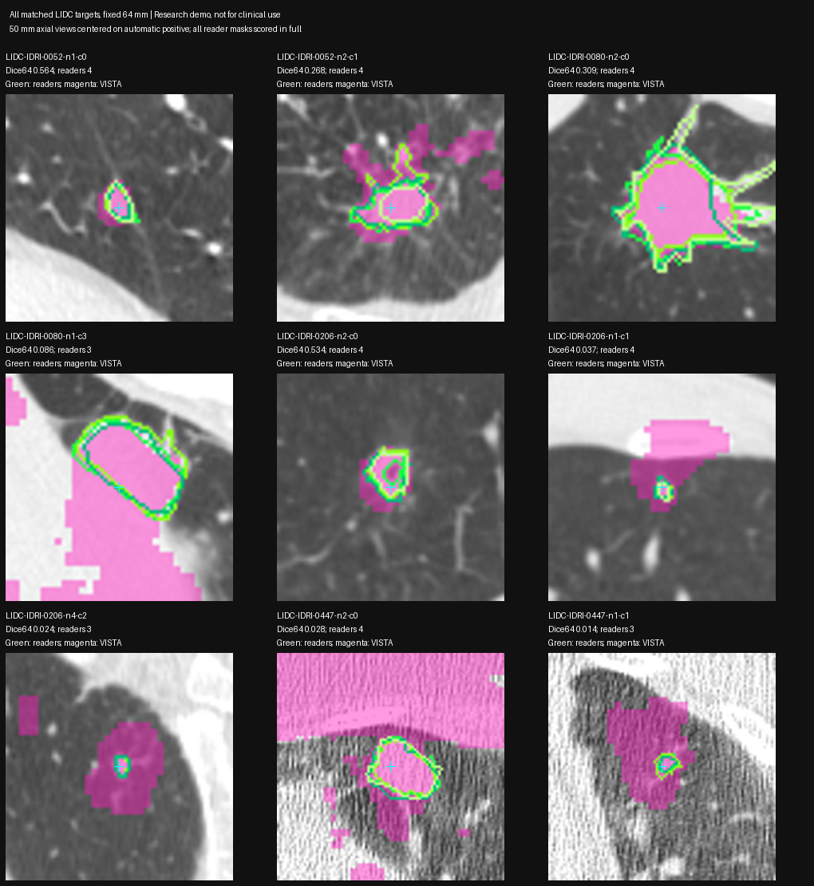
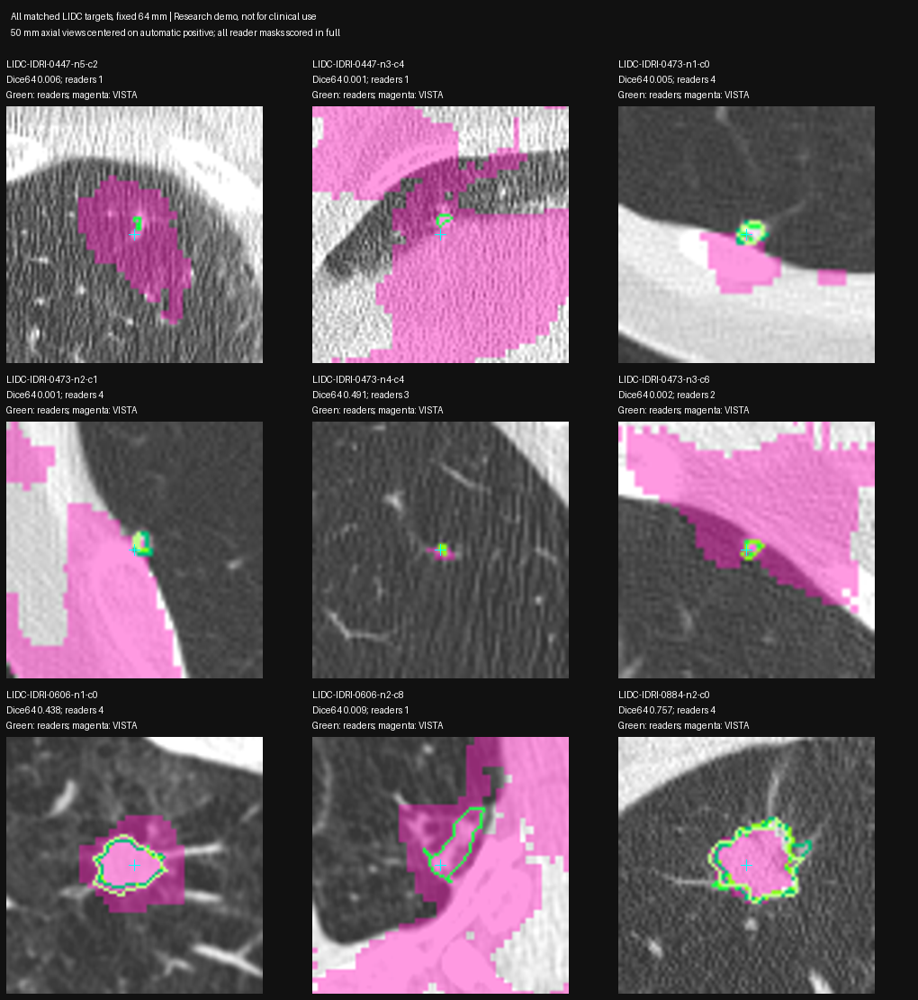

# VISTA vs LIDC reader contours and crop stability — 2026-10-24

Status: **FAILED reader-agreement and crop-stability evaluation for this configuration**; frozen rule `lidc-crop-stability-v1`. Preparation/evaluation only, no accepted clinical measurements.

## Cohort and alignment

Eight staged LIDC-IDRI cases contain 85 individual DICOM SEG annotations. Each SEG is retained separately. Decode exact per-frame source SOP references and physical geometry into original CT voxel coordinates. Verify FrameOfReferenceUID, source series, frame plane, grid bounds and integer mapping. Verify remote NIfTI shape/affine and exact HU hashes against three actual source CT slices (first/middle/last) per case before running VISTA.

**0415 excluded before scoring or model inference:** converted SEG declares IOP `[1,0,0,0,1,0]`, while its referenced CT declares `[-1,0,0,0,-1,0]` at the same first-pixel origin (example `[167.2,155,-209.75]`). Physical mapping leaves CT bounds. Do not blindly flip or reinterpret these annotation arrays to improve overlap. Source XML can be investigated separately. This is a reference-data alignment exclusion, not a model-quality exclusion.

Remaining **7 cases, 22 annotated nodule groups, 61 individual annotations** pass source SEG geometry checks. Maximum physical grid-mapping residual ~2.92e−5 mm. Geometry verified on 0052/0080/0206/0447/0473/0606/0884. Multiple annotations are reader observations, not a single indisputable ground truth; original per-reader disagreements remain visible.

## Frozen selection and prompts

- Code `bench/lidc_references.py`, `bench/vista_lidc_probe.py`, `bench/lidc_score.py`. Fresh remote experiment `~/spark-md-b/vista-lidc-20261024-01/`; references `~/spark-md-b/lidc-references-20261024/`.
- Detector candidates score ≥0.5. Compute every qualifying candidate seed from CT/detector only **before** annotation matching: unchanged detector-box HU ≥−400 nearest component, deepest physical EDT voxel, no opening. Reader contours/centroids do not move or select a prompt voxel.
- Evaluate all matched annotated groups using one-to-one minimum-distance assignment to median annotation centroid, distance ≤10 mm and physical predicted-box/reference-bbox overlap. Report unmatched groups, unmatched candidates and seed failures. This is **conditional segmentation evaluation on matched high-confidence candidates**, not full screening sensitivity/specificity or an unbiased sample of lung nodules.
- Run 48/64/96 mm detector-centered crops, identical physical positive for all three, no negatives/class prompts, no mask cleanup. Same local-crop geometry/restoration rules as the previous 64 mm experiment. Preserve failures.
- Repeat crop sizes for hero 134503 T0/T1/T2 using existing Farina-assisted candidate identities, without a reference contour; these contribute stability evidence only, not reader-accuracy metrics.

## Metrics

Each output vs **each complete reader mask**, never truncating the reader mask to the model crop: Dice, IoU, signed relative volume error, average and pooled-95th-percentile symmetric boundary distance in physical mm. Boundary samples are centers of 6-neighbor boundary voxels. Aggregate by nodule-group median across readers so groups with more readers do not count more heavily.

Also report inter-reader pairwise Dice, size bins based on median reader equivalent-sphere diameter (<6 / 6–<10 / ≥10 mm; descriptive, not clinical categories), crop-to-crop Dice, and `(largest volume − smallest volume) / volume at 64 mm`. No growth, VDT or Lung-RADS derived.

Coarse technical gates unchanged from the previous crop probe: positive included, allowed labels, original geometry, ≥5 mm crop-edge margin, bounding/volume outlier limits relative to detector box. These do not establish contour accuracy.

## Results

**18/22 eligible annotated groups matched**, 57 individual reader annotations, no matched seed failures. Four unmatched groups remain separate in `matching.json`. Plus three hero targets, **63 VISTA calls** total. Matched size bins: nine <6 mm, two 6–<10 mm, seven ≥10 mm, using median reader equivalent-sphere diameter (not clinical long/short axes).

All raw model outputs and failures are retained. No crop size was selected or parameters changed after examining scores.

| Crop side mm | Median group→reader Dice (18 groups) | Technical passes | Empty predictions | Median group→reader pooled HD95 mm |
| --- | ---: | ---: | ---: | ---: |
| 48 | 0.0644 | 4/18 | 2 | 21.21 (16 nonempty) |
| 64 | 0.0327 | 5/18 | 0 | 26.36 (18 nonempty) |
| 96 | 0.0231 | 6/18 | 1 | 45.82 (17 nonempty) |

Dice is 1 for identical masks, 0 for disjoint masks. Aggregates are medians of each nodule group's median across its readers. At 64 mm the median absolute relative volume error is **57.62** (a fraction, ~5,762%), reflecting severe inclusion of surrounding regions; raw reader-specific values are in `scores.json`. The 64 mm size-bin median Dice is 0.0061 (<6 mm), 0.2868 (6–<10 mm, only two groups), 0.3085 (≥10 mm).

**Reader disagreement does not explain this result:** among the same 15 multi-reader groups, median per-group reader-pair Dice is **0.7750**, whereas model→reader median is **0.0863**. The other three matched groups have one annotation each. In the 14 groups where the automatic positive is inside *every* reader mask, model median Dice64 is still only **0.0617**. Thus occasional seed misses are a contributor, not a sufficient explanation for the poor aggregate.

Inspected axial/coronal overlays for all 18 targets show coherent green reader outlines on the actual CT target, with many VISTA masks including surrounding lung, pleura or other tissue. Some masks are compact and agree moderately/well; the best group median Dice64 is 0.7567. Coarse technical checks do not establish accurate boundaries even when they pass. Examples and all-target contact sheets are below; views are 50 mm around the fixed automatic positive, while all metrics use complete masks.

## Crop stability and repeatability

Across LIDC targets the median `(max volume − min volume) / volume64` is **1.00 (100%)**. This is a descriptive sensitivity measure, not a test/retest clinical repeatability estimate. Gross failures are included.

| Hero timepoint | Volume48 mm³ | Volume64 mm³ | Volume96 mm³ | Volume span / volume64 | Lowest crop-pair Dice |
| --- | ---: | ---: | ---: | ---: | ---: |
| T0 | 330.3 | 347.4 | 135.4 | 61.0% | 0.485 |
| T1 | 560.2 | 552.8 | 329.9 | 41.6% | 0.633 |
| T2 | 929.7 | 774.3 | 1,326.9 | 71.4% | 0.682 |

The three 64 mm hero masks **bitwise reproduce the previous 64 mm run**, with matching affines. This rules out random rerun variation as the explanation for these particular crop-size differences. Crop context, padding, resampling-grid phase and point-conditioning effects are not isolated. Do not select whichever crop happens to agree best with NLST size reports.

## Interpretation / next diagnostic

**Do not adopt this point-only automatic crop configuration for nodule measurements, growth, VDT or categories.** Earlier hero-only compact-mask results were a coarse technical pass; this contour evaluation and crop-size check fail the stronger test. Historical wrong-target T0 fallback numbers remain invalidated; no accepted replacement is established.

This conclusion applies to the exact local checkpoint, wrapper, MONAI compatibility shims, automatic HU seed and point-only prompting tested here. It does not establish that every VISTA configuration is unsuitable. Next isolate the documented point/class conditioning and checkpoint/reference-runner compatibility on an aligned LIDC target before further crop tuning. Keep explicit failed-analysis behavior rather than exporting unreviewed masks into reports.

Limitations: seven selected patients, 18 matched high-confidence detections, conditional matching using reference centroids for evaluation only, four unmatched groups and one geometry-excluded case, imperfect reader contours, no guarantee of model-training holdout, no broad clinical performance claim. Annotation-free automatic seed selection was frozen before matching; scoring/visualization never changed prompts or masks.

## Runtime and evidence

spark-2 GB10; TensorFold/OpenClaw untouched and running. Start ~70 GiB host MemAvailable; one imaging process; GPU probe samples every 0.5 s and aborts below 15 GiB. Local weights/offline flags and established MONAI/transformers shims. Exact wheelhouse torch 2.13 unverified.

Reference decode command (laptop x86 venv): `python bench/lidc_references.py --dicom data/dicom/lidc_idri --out tmp/lidc-vista-references-v3 --exclude-case LIDC-IDRI-0415`. Remote prepare/infer command: `~/venvs/spark-md-arm/bin/python ~/spark-md-b/vista_lidc_probe.py <stage> --out ~/spark-md-b/vista-lidc-20261024-01 --refs ~/spark-md-b/lidc-references-20261024`. Scoring: same venv, `~/spark-md-b/lidc_score.py --out ... --refs ...`.

Full cropped inputs, raw NIfTI outputs, sparse prediction coordinates and reader coordinates remain at the remote experiment/reference paths. Local evidence: `2026-10-24-vista-lidc/` contains frozen rule, jobs, candidate seeds, alignment/matching reports, result/scores JSON, reference manifest and hashes, all overlays, sanity checks and the explicit rejection review. Reader NPZ files are reproducible from staged SEG using the extractor; their hashes and source hashes are in the reference manifest.

Minimum host MemAvailable **63.89 GiB**, sampled every 0.5 s, TensorFold/OpenClaw running. Model load 6.01 s; all 63 calls completed. GPU inference and subsequent CPU scoring/overlay processes exited; no experiment process left running, existing services untouched. Torch 2.14.1+cu130 / MONAI 1.6.1 / transformers 4.46.3. Exact wheelhouse torch 2.13 remains unverified. Metric sanity checks cover identical masks and a one-slice displacement under a non-diagonal affine (exactly 2 mm boundary distance). LIDC-IDRI/TCIA CC BY 3.0 via IDC; DICOM SEG analysis series cite DOI `10.7937/tcia.2018.h7umfurq`. Full dataset citations in `data/README.md`.

