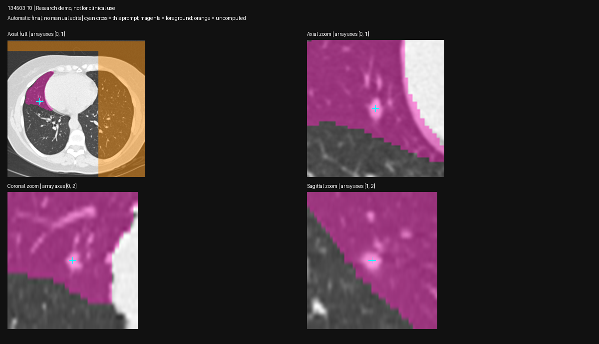
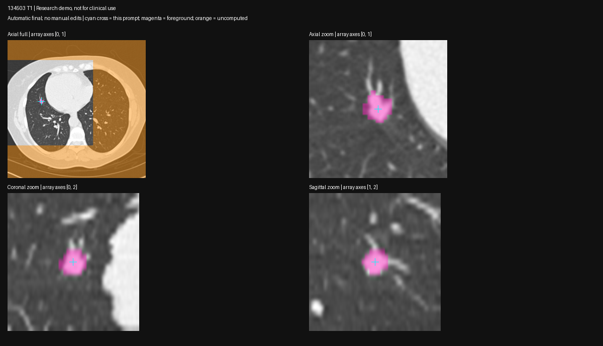
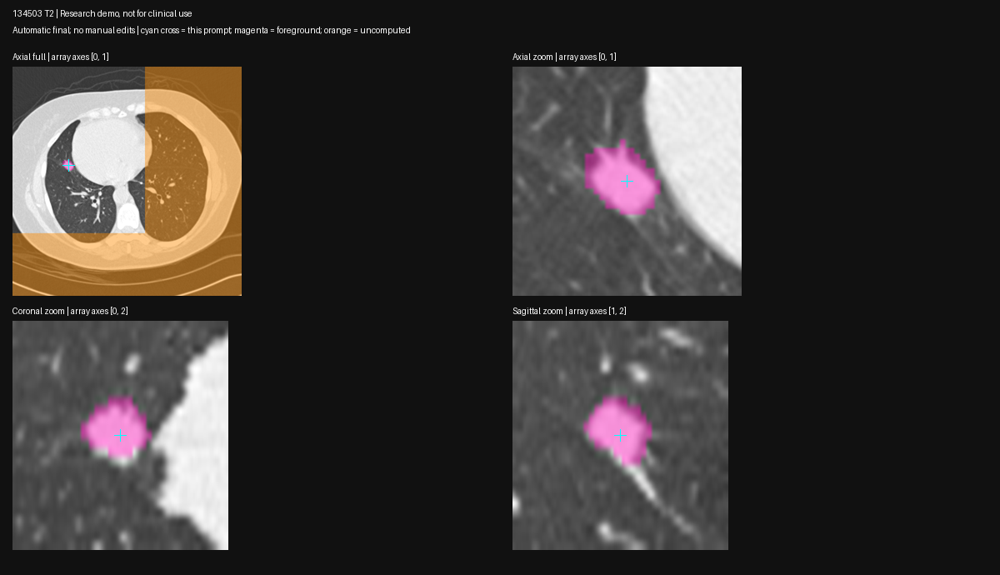

# VISTA automatic hero sequence — 2026-10-24

Status: **three-year consistency test FAILED on T0 under both frozen prompt rules; no mask sequence accepted for growth**. Machine spark-2 GB10. Preparation experiment, not a product implementation or clinical validation.

## Frozen method

Rule `hero-two-pass-v1`, frozen in `~/spark-md-b/vista-probe-20261024-03/rule.json` before any sequence inference. Code `bench/vista_longitudinal_probe.py`. Identical parameters on hero 134503 T0/T1/T2, no manual prompt corrections, no editing based on results.

1. Use existing tracked-candidate centers from `farina_tracked.json`; these were selected using Farina reference locations. **Candidate identity and cross-year matching are supplied inputs**, not validated automatic outputs in this experiment.
2. Convert LPS mm to RAS mm (negate physical x/y), then inverse NIfTI affine to original image voxels. Recompute the existing threshold-ROI fallback unchanged; failure to get a seed is an explicit failure, not manually rescued.
3. Choose the first maximum of physical Euclidean distance inside that fallback as the positive point. No scan-specific thresholds.
4. First VISTA pass uses the corrected detector point, label `[1]`. Derive eligible negative voxels from its label-1 foreground: HU >−400, >4 mm outside the fallback, >12 mm from the centered positive. Choose nearest to positive, then farthest from that first negative; omit duplicates. If none qualify, use no negatives. This reproduces experiment 02's T2 selection procedure without manual inspection gating.
5. Second VISTA pass uses the centered positive plus zero to two automatic negatives. Decode `==1`, verify output grid, inspect CT overlays **after the unchanged algorithm runs**. No clipping, smoothing or component removal of VISTA output.
6. Compare original-grid volume and descriptive 3D PCA extents with fallback and NLST reported mean diameters. PCA extents reproduce the historical fallback proxy and are **not validated axial clinical long/short diameters**; no Lung-RADS category is assigned from this experiment. Compute volume doubling time with actual screen-day intervals 357/420 days, evidence-only.

Offline local weights; same MONAI/transformers shims as experiments 01/02. TensorFold/OpenClaw remain running. Start ~69 GiB host MemAvailable; one imaging process; 0.5 s memory sampling and abort below 15 GiB during GPU inference. Preparation uses CPU threshold/EDT operations. Exact event wheelhouse torch 2.13 remains unverified.

Commands on spark-2: `~/venvs/spark-md-arm/bin/python -u ~/spark-md-b/vista_longitudinal_probe.py prepare --out ~/spark-md-b/vista-probe-20261024-03`, then the same command with `infer`. The rule and prepared positive points are saved before inference. Fresh directories only; no inference caches reused.

## Results

The frozen v1 rule failed T0: the threshold pipeline lost the target seed and its component selection returned heart-boundary tissue, 18.46 mm from detector center, outside the ~7 mm detection box. Final T0 VISTA output is ~428,424 mm³ with ~112×114×112 mm extent. **Reject it and all T0-dependent growth from this run.** Historical fallback T0 4.56 mm / 29.7 mm³ and T0→T1 VDT 140 days are now unvalidated for the tracked nodule; they must not be reused as confirmed patient evidence. Rule-engine input examples do not validate those measurements.

T1 is localized: 574.8 mm³, extent 10.3×10.9×10 mm, positive-only (no eligible negatives). T2 reproduces the previous refined output exactly: 1,371.7 mm³, extent 13.5×16.8×14 mm, two negatives. v1 minimum available 62.51 GiB; no imaging process remained after it exited. Geometry alone passed all three and therefore would not detect this wrong-target failure.

## Detector-box follow-up (v2)

A separate frozen `hero-two-pass-box-v2` uses the same two-pass/negative rule but replaces the threshold fallback seed: restrict HU ≥−400 to the detector's physical bounding box, keep the 6-connected component nearest detector center, do not apply opening, then choose its deepest physical-EDT voxel. This removes erosion as a possible source of small-nodule seed loss and stops the positive point jumping outside the box. The separate contributions of the old lung mask, opening and nearest-component selection were not isolated. It does **not** clip the final VISTA output. The same rule applies to all three timepoints; no manual prompts.

Fresh remote directory `~/spark-md-b/vista-probe-20261024-04/`. Same commands plus `--seed-mode detector-box`. Rule and positives saved before inference. V2 positive shifts are 2.09/2.52/4.37 mm from detector center; original voxel points `[230,391,59]`, `[228,386,66]`, `[220,385,66]`. The T0 seed visibly falls within the actual nodule instead of heart-boundary tissue. V2 seed volume is a prompt aid, not a replacement clinical measurement.

V2 completed unchanged on all three scans:

| Timepoint | Final volume mm³ | Bounding extent mm | Positive shift from detector mm | Negative count | Review |
| --- | ---: | --- | ---: | ---: | --- |
| T0 | 980,087.3 | 157.5 × 119.8 × 226 | 2.09 | 2 | **FAIL:** lung-scale foreground despite point inside visible nodule; one negative remains foreground |
| T1 | 585.8 | 12.1 × 10.9 × 10 | 2.52 | 0 | Localized in inspected planes; boundary accuracy unverified |
| T2 | 1,793.8 | 18.0 × 16.8 × 16 | 4.37 | 2 | Localized in inspected planes; boundary accuracy unverified |

The T0 positive is correctly inside the ~7 mm detector box and visibly in the nodule, so fixing seed drift alone does not solve small-nodule point-prompt segmentation. Output geometry matches input in every case; geometry and connectedness are insufficient quality checks. V2 T0 is one connected region, yet its mean HU is −866.85 and its large extent/overlay show lung-scale inclusion. No output clipping or manual rescue was applied.

Pipeline times (initial + final, excluding separate CPU seed preparation and subsequent diagnostic analysis): T0 3.17 + 2.15 s, T1 1.78 + 1.76 s, T2 1.76 + 2.22 s. Model load and all exact values are in `v2/results.json`. Minimum host available 62.73 GiB at 0.5 s sampling. Both runs exited; no imaging process remains. LLM/OpenClaw left running.

**Reject all T0-dependent measurements/growth from both VISTA runs.** The raw benchmark scripts compute descriptive growth before visual review; those raw fields are not approved findings. `review.json` explicitly rejects the sequence. Even T1→T2 VDT varies from 334.7 d (v1) to 260.1 d (v2), despite both masks looking localized: prompt/seed sensitivity remains material. Do not replace the original clinical/report payload with either run.

Next technical experiment: isolate small-nodule behavior using a detector-centered local crop and/or the bundle's documented zero-shot class prompting, with geometric restoration and independently reviewed boundaries. Test any new rule on all three scans again, then compare with LIDC reader masks. Meanwhile, build a fail-closed seed/segmentation quality gate; return an explicit analysis failure rather than a lung-sized mask or silently substituting another tissue component.

## Evidence and attribution

Full masks remain in `~/spark-md-b/vista-probe-20261024-03/`. Raw summaries, prompts, transforms, logs, images and hashes are in `2026-10-24-vista-longitudinal/v1/` and `/v2/`; review is in `2026-10-24-vista-longitudinal/review.json`. The runner was extended after v1 to add the separate detector-box mode; the recorded v2 source hash identifies the final runner supporting both modes. Each run retains its pre-inference frozen rule. Full masks remain remote, with per-mask SHA256 in result JSON. NLST/TCIA CC BY 4.0, obtained via IDC; Farina locations used for candidate selection. Full citations in `data/README.md`.

