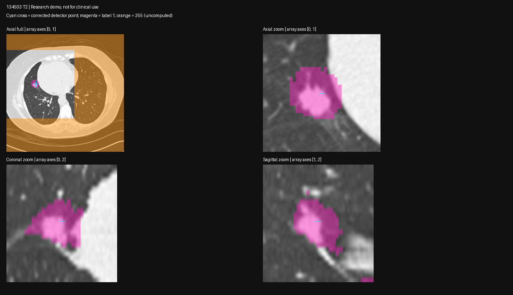

# VISTA single-point diagnostic — 2026-10-24

Status: **coordinate and output-label defects confirmed; corrected run locates the nodule, but segmentation quality fails the nodule-only check.** Keep threshold-ROI measurements as the current fallback.

## Method and reproducibility

- Machine: spark-2 GB10; TensorFold and OpenClaw stayed running. One GPU imaging probe; no other imaging workload observed. Start available memory ~73 GiB, abort floor 15 GiB, sampled every 0.5 s. Probe exited; post-run available memory ~72 GiB. No persistent imaging service started.
- Input: hero 134503 T2, `~/spark-md-b/vols/134503_45037002.nii.gz`, original array `[512,512,152]`, axis codes P/L/S, spacing `[0.64453125,0.64453125,2]` mm. NLST/TCIA data obtained via IDC; attribution and license: `../../data/README.md`.
- Code: `bench/vista_point_probe.py`. Uses the existing remote VISTA bundle with its documented transformers/weight and MONAI shims. Offline flags set before inference. Versions, input/model/pipeline hashes and raw trace are in `2026-10-24-vista-point/`.
- Commands on spark-2, from a fresh output directory: `~/venvs/spark-md-arm/bin/python ~/spark-md-b/vista_point_probe.py prepare --out ~/spark-md-b/vista-probe-20261024-01`, inspect prompt PNG, then the same command with `infer` instead of `prepare`.
- No old segmentation reused. The existing old output was inspected read-only as a control. Preflight verified the corrected point visually on axial/coronal/sagittal CT slices. Fresh saved output was checked for labels, shape, affine, prompt inclusion and connected components; overlaid on the original CT, reoriented to RAS for display only.
- Full NIfTI output remains at `~/spark-md-b/vista-probe-20261024-01/segmentation/134503_45037002/134503_45037002_seg.nii.gz`. Local raw JSON, inference log, memory samples, hashes and overlay: `2026-10-24-vista-point/`.

## Findings

1. **The old prompt was outside the image.** Detector LPS center `[63.2965,-195.2223,-201.4098]` mm was fed directly into the inverse RAS affine, giving original voxel `[822.148,185.222,67.495]`. First axis only has 512 voxels. After negating physical x/y, the correct original voxel is `[216.367,381.633,67.495]`, visibly in the nodule, rounded-voxel HU −1. Physical roundtrip error ~2.8e−14 mm.
2. **The old chest-scale mask was a decoding artifact.** Its labels are 8,467,968 background voxels and 31,377,920 label-255 voxels, with **zero label-1 voxels**. The pipeline explicitly maps NaNs to 255. `mask > 0` therefore measured uncomputed regions, not a nodule. For point-only inference without a class prompt, foreground is `mask == 1`.
3. **The wrapper handles original→processed voxel conversion correctly for the corrected point.** Captured processed point `[56.017,127.030,89.993]`; full affine conversion in `point-transform.json`. Saved shape and affine match the input. No additional output-space correction was needed in this run.
4. **The resulting foreground still over-segments.** 10,571 foreground voxels = 8,782.8 mm³, bounding extent `[72.19,28.36,62]` mm along original array axes, across six 6-connected components. The component containing the prompt has 10,530 voxels = 8,748.8 mm³, spanning `[72.19,27.07,62]` mm. Keeping only that component does not fix it. The overlay shows coverage beyond the nodule, including surrounding tissue/attachments. Compare previous threshold-ROI T2 volume 836.7 mm³ and NLST-reported 14×14 mm; neither is voxel ground truth, but the full VISTA foreground is unsuitable as a nodule-only mask.

## Timing and headroom

Measured by `time.perf_counter`, in this one run on spark-2, Oct 24: model initialization 6.70 s; pipeline (preprocess/inference/postprocess/save) 3.96 s. Minimum host MemAvailable 67.17 GiB at 0.5 s sampling; torch 2.14.1+cu130, MONAI 1.6.1, transformers 4.46.3. Exact event wheelhouse torch 2.13 and complete application co-load remain unverified. This is one scan, not a latency distribution or cohort quality evaluation.

## Next experiment / limits

Follow-up completed: `2026-10-24-vista-refine.md` reports a centered foreground plus two negative prompts reducing T2 foreground to a compact single region; automatic accuracy remains unverified. Keep fresh directories and the same geometry/label checks. Do not substitute this first VISTA volume into growth, VDT or categories. Lobe segmentation, other hero timepoints, controls and LIDC accuracy remain outside this experiment.

Additional caller defect found by inspection: legacy `b5_characterize.measure` uses the affine diagonal for voxel spacing. This input has a non-diagonal affine with zero first/second diagonal entries. Use column norms for axis lengths and `abs(det(affine[:3,:3]))` for voxel volume; verify grid agreement before combining mask and HU array. The probe uses these geometry-safe quantities, not the legacy measurement function.

