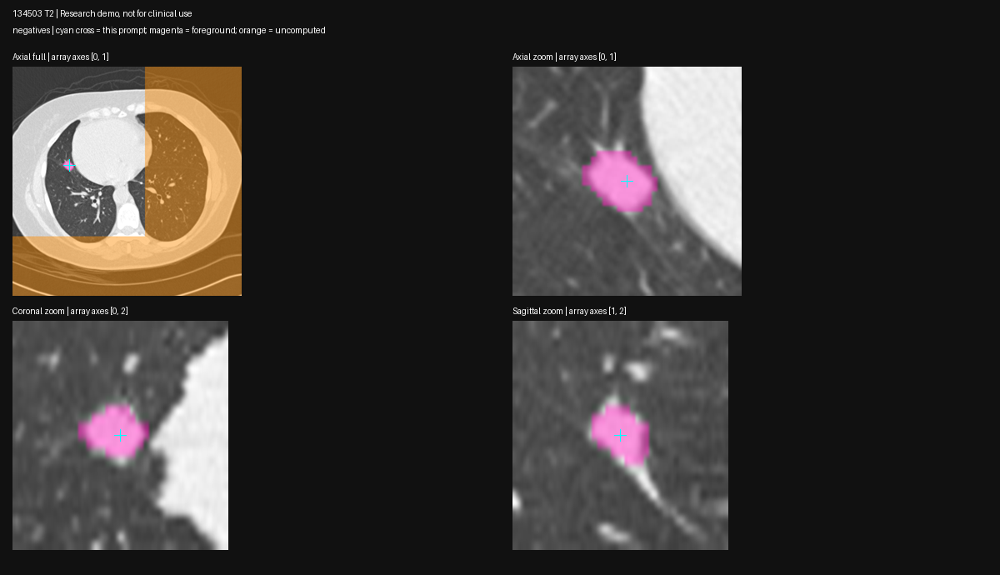

# VISTA foreground/negative-point refinement — 2026-10-24

Status: **guided refinement improved this scan; automatic accuracy remains unverified**, 134503 T2 on spark-2 GB10. Follows `2026-10-24-vista-point.md`; this is a controlled prompt experiment, not cohort validation.

## Method

- Same original CT, local model, MONAI/transformers shims, offline flags and label-1 decoding as experiment 01. TensorFold/OpenClaw remain running; one imaging GPU process; start ~73 GiB host MemAvailable, stop probe below 15 GiB, sample every 0.5 s.
- Code `bench/vista_refine_probe.py`, sharing geometry/preview functions from `bench/vista_point_probe.py`. Fresh remote directory `~/spark-md-b/vista-probe-20261024-02/`. Run `prepare --out <directory>`, inspect all prompt images, then `infer --out <directory>` using `~/venvs/spark-md-arm/bin/python ~/spark-md-b/vista_refine_probe.py`.
- Foreground proposal: voxel with maximum Euclidean distance to the boundary inside the existing threshold-ROI fallback, with physical voxel spacing. This reproduces the fallback's 1,007 voxels / 836.657 mm³. New positive point `[221,384,66]` in original-image voxel space, HU 80, 4.01 mm inside that mask; shifted 4.49 mm from the corrected detector point.
- Negative proposals: previous VISTA foreground with HU >−400, >4 mm outside fallback and >12 mm from the new foreground point. Choose nearest, then the voxel farthest from it. Negative points `[226,375,71]` and `[127,376,53]`, HU −184/−374; 12.00/66.13 mm from new foreground, 4.93/60.25 mm outside fallback. Inspected on axial/coronal/sagittal CT: one near the superior/adjacent tissue, one in a distant region included by the first mask.
- **No ground-truth nodule mask is available for this NLST scan.** Fallback-guided point selection and overlap against that fallback are diagnostics only; higher overlap or smaller volume alone does not establish accuracy. These manually inspected prompts do not validate an automatic pipeline.
- Run A: centered positive point, labels `[1]`. Run B: same positive plus both negatives, labels `[1,0,0]`. Identical model and settings, sequential calls. Capture transformed prompt coordinates, output labels/grid, point inclusion, prompt-connected component, fallback overlap and CT overlays at the positive and both negatives.

## Results

Measured on spark-2 GB10, Oct 24, same scan and model. Volumes count only label 1 and use the original-affine determinant. Extents below are array-axis bounding-box lengths including one voxel, **not Lung-RADS long/short diameters**.

| Prompt | Foreground volume mm³ | Bounding extent mm | Components | Pipeline seconds |
| --- | ---: | --- | ---: | ---: |
| Original corrected detector point (experiment 01) | 8,782.8 | 72.2 × 28.4 × 62 | 6 | 3.96 |
| Centered foreground only | 3,089.1 | 19.3 × 20.6 × 18 | 1 | 4.34 |
| Centered foreground + two negatives | 1,371.7 | 13.5 × 16.8 × 14 | 1 | 2.11 |

Both new outputs have exactly the CT shape/affine, include the positive point, and exclude both proposed negative locations. The centered-only output already excluded those two locations; adding negatives changed the surrounding boundary further. The negative-prompt run computes a larger region (fewer label-255 voxels), so prompt effects include changes to the point-window coverage; these calls do not isolate each negative's independent contribution.

Visual inspection: centered-only removes the distant extension but retains a broad halo around the nodule. The two-negative run is more tightly confined around the visible nodule in the inspected axial/coronal/sagittal planes and excludes the adjacent/distant regions at the negative-point views. No radiologist-reviewed contour or full-volume voxel ground truth was available, so this is a qualitative improvement, not an accuracy score.

Against the threshold fallback, centered-only covers 99.1% of fallback voxels (Dice 0.422); the two-negative run covers 94.1% (Dice 0.713). **These are agreement measures against a heuristic used to select prompts, not independent validation.** Final volume is still ~1.64× the fallback's 836.7 mm³. NLST reports 14×14 mm; bounding-box agreement alone does not validate boundaries or measurement.

Model initialization 6.62 s. Minimum host MemAvailable 63.83 GiB at 0.5 s sampling, with TensorFold/OpenClaw running. Probe exited, no imaging process remains; post-run available memory ~69 GiB. Timing is one invocation per condition, not a benchmark distribution; the second inference is warm. Torch 2.14.1+cu130 / MONAI 1.6.1 / transformers 4.46.3 as in experiment 01. Exact wheelhouse torch 2.13 remains unverified.

Keep the existing fallback for production-path measurements/growth/categories. The next validation should test a reproducible prompt strategy across T0/T1/T2, and use LIDC reader masks for independent boundary evaluation. If continuing prompt ablations, compare near-negative-only and far-negative-only against this same centered point; the current test cannot say which negative caused the improvement.

## Evidence and attribution

Full masks remain in the remote output directory. Raw summaries, memory log, point transforms, prompt/overlay PNGs and hashes are in `2026-10-24-vista-refine/`. Input source: NLST/TCIA (CC BY 4.0), obtained via IDC; complete citations in `data/README.md`.

